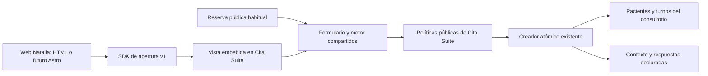

# Integración de reservas: Cita Suite y Web Natalia

Estado: pieza de integración implementada en el workspace y probada con infraestructura local desechable, deshabilitada por defecto. La activación de un consultorio real y la migración del sitio son etapas posteriores. La carpeta `WEB NATALIA` conserva su maqueta. No se crearon consultorios reales, no se migró su contenido simulado, no se aplicaron cambios remotos ni se publicó este código.

## Decisión y motivo

Cita Suite hospeda el turnero completo. Web Natalia únicamente abre una vista embebida con su apariencia. Esa vista utiliza el mismo componente de reserva, calculador de disponibilidad, políticas públicas y creador atómico que el turnero habitual. Ambos escriben en las tablas existentes del mismo `business_id`. No hay segunda agenda, sincronización periódica ni una copia de las reglas en Natalia.

El marco embebido evita que Astro, HTML, React o un cambio del sitio anfitrión se conviertan en dependencias del negocio. Natalia no necesita credenciales Supabase, un servidor propio para reservar, ni actualizar código cada vez que Cita Suite agrega un paso. Cita Suite controla ese paso dentro del marco. El protocolo externo sólo administra abrir, cerrar, tema, tamaño y una señal de finalización sin datos personales.

Esto mantiene la identidad visual actual como una capa de presentación. La infraestructura incluye el tema Natalia con colores y tipografías de la maqueta, variantes clara/oscura y un flujo compacto para un único profesional configurado. No equivale todavía a una migración completa ni a una certificación visual píxel por píxel del sitio funcional. Esa validación corresponde a la migración posterior con contenido y configuración reales.

## Presentación dentro del diseño existente

La referencia visual sigue siendo `WEB NATALIA/index.html` y `WEB NATALIA/styles.css`: títulos con Newsreader, texto e interfaz con Hanken Grotesk, superficies cálidas y acento terracota, con su variante oscura. `BookingAppearance.svelte` aplica esa identidad al flujo compartido; el SDK sólo aporta el contenedor de apertura. Es una extensión del diseño existente, sin sustituir la maqueta ni crear una identidad nueva. La equivalencia de branding no implica igualdad de cada medida, superficie o composición.

El modo compacto agrupa la presentación del mismo formulario para un perfil individual con un único profesional configurado. Conserva selección, validaciones, preguntas, comprobante y recuperación del motor común. Los estados de error, éxito, aviso y advertencia tienen colores propios para cada tema; no dependen de que un color pensado para la interfaz oscura original también se lea sobre una superficie clara.

La gestión de un turno permanece en la página superior compartida. En modalidad virtual muestra modalidad e instrucciones de acceso y adapta el texto del calendario a esos datos. La dirección y el enlace de llegada físicos corresponden a la modalidad presencial. La revisión de las correcciones visuales F1/F2 y sus límites se registra en [activación y verificación](activation.md#revisión-visual-resuelta).

## Fronteras que deben mantenerse

- `packages/shared/src/booking-integration.ts`: contrato externo y formatos declarativos soportados.
- `apps/web/static/booking/embed-v1.js`: anfitrión independiente del framework, sin reglas de turnos.
- `PublicBookingFlow.svelte` y `public-booking-page.ts`: único flujo público para ambas presentaciones.
- `public-booking.ts`, `availability.ts`, `availability/calculate.ts`, `appointments.ts`: lógica compartida existente.
- `create_integrated_public_appointment`: envoltorio transaccional de `create_appointment_with_patient_identity`, que añade restricciones y contexto sin reemplazar su resolución de pacientes ni su exclusión de horarios.

El consultorio se obtiene de un registro privado de integración. Nunca se toma un `business_id` aportado por el navegador anfitrión. Una clave pública opaca y estable identifica ese registro; no es una credencial de escritura. Las funciones y tablas privadas no se exponen a `anon`.

## Configuración y datos persistidos

`booking_integrations` guarda consultorio, clave, revisión, versión, dominios exactos, servicios y profesionales permitidos, modalidades, ventanas de modalidad, indicaciones virtuales y definición del formulario. Se crea inactivo. Su consultorio, identificador y clave no pueden reasignarse. Un índice permite un único perfil público predeterminado por consultorio.

Para Natalia, `is_default=true` hace que el enlace habitual de Cita Suite aplique el mismo perfil: catálogo, modalidades, restricciones y preguntas. Sólo la presentación cambia a Cita Suite. Perfiles adicionales pueden tener otro alcance; esa diferencia es explícita, no una divergencia accidental. El asistente de configuración exige servicios y profesionales concretos; en el almacenamiento, listas vacías significan todo lo elegible del consultorio y deben usarse únicamente de forma deliberada.

`appointment_booking_contexts` guarda origen, integración y revisión usadas, modalidad, tema e instrucciones virtuales como fotografía histórica. Cambiar la configuración mañana no modifica lo que se informó en una reserva existente. `appointment_intake_responses` guarda preguntas y respuestas de ese momento, el paciente original y un comentario privado opcional.

Obra social, medicación o estudios declarados no sobrescriben automáticamente la ficha clínica. Un teléfono compartido por una familia tampoco implica un único paciente: se conserva la resolución prudente existente por nombre y teléfono, y los casos ambiguos generan una nueva ficha para revisión humana. No se implementa aquí verificación de identidad, autorización de tutores ni fusión automática de fichas.

Las respuestas clínicas se leen mediante el cliente autenticado y la política clínica existente. Recepción puede ver el contexto operativo, pero no esas respuestas. Otra empresa no ve ninguno. La vista de un turno reasignado no muestra respuestas del paciente anterior. Los comentarios del nuevo flujo no se copian a las notas operativas generales. Un booleano obligatorio exige contestar Sí o No; `false` es una respuesta válida. Ese campo no implementa una aceptación obligatoria de términos o consentimiento, que requeriría una validación específica en el motor común.

## Reserva, carreras y recuperación

1. La página consulta disponibilidad con el motor existente: zona horaria del consultorio, duración, buffers, descansos, reglas, excepciones, anticipación, horizonte y equipo conjunto.
2. La confirmación vuelve a consultar disponibilidad. El horario visible es una opción, no una retención exclusiva.
3. Se captura una revisión del negocio antes de leer los horarios. Los cambios relevantes del negocio, servicios, profesionales, asignaciones y disponibilidad incrementan esa revisión.
4. La transacción final verifica revisiones y bloquea las filas de configuración correspondientes. Si hubo un cambio entre cálculo y confirmación, obliga a volver a elegir. La exclusión existente en la base decide si dos reservas intentan ocupar al mismo profesional.
5. Paciente, turno, asignaciones, contexto y formulario se guardan juntos. Una falla posterior revierte también la ficha recién creada; no queda un paciente huérfano por una reserva rechazada.

La reserva tiene una referencia aleatoria de intento. El mismo intento y contenido devuelven el mismo resultado; cambiar su contenido después de guardarlo genera un conflicto explícito. El envoltorio conserva el esquema original para reproducir una reserva ya guardada aunque su configuración haya cambiado. La disponibilidad actual no invalida el resultado comprometido.

El SDK conserva únicamente esa referencia en `sessionStorage`, nunca nombre, teléfono o respuestas. Es una capacidad de recuperación y debe excluirse de analytics, logs de URL y herramientas de grabación. Si el almacenamiento está bloqueado, el flujo actual sigue operando; se pierde la recuperación automática después de cerrar o recargar toda la página anfitriona.

Si una respuesta se pierde, la interfaz distingue resultado desconocido de reserva rechazada, conserva el intento y exige consultar el resultado antes de confirmar nuevamente. La recuperación consulta un turno de la misma integración y origen de entrada; no crea nada. Si una transacción todavía no terminó, un reintento con la misma referencia queda protegido por el bloqueo y la idempotencia. No se interpreta un fallo de consulta como prueba de que no hubo reserva.

Cerrar el modal mantiene el marco vivo para no interrumpir un guardado. Destruir el widget o abandonar toda la página puede cortar la respuesta; la referencia permite recuperar al volver. Una nueva intención se genera al elegir reservar otra consulta después del comprobante. Reiniciar los pasos conserva la referencia de la intención actual.

## Modalidades y evolución de la agenda

Presencial y virtual ocupan el mismo recurso profesional y se bloquean mutuamente. Virtual no habilita una agenda paralela. El comprobante, calendario y recordatorio virtual no indican acudir a la dirección física; muestran las instrucciones guardadas para ese turno.

Las franjas de modalidad son una restricción sobre la disponibilidad común, no horarios independientes. Sin franjas de una modalidad para un profesional se utiliza su disponibilidad normal. Si hay franjas, sólo se permite la atención con sus buffers dentro de una franja correspondiente. Los descansos siguen condicionando la siguiente reserva según las reglas existentes. Las franjas no alteran la grilla original ni habilitan días cerrados. Cada franja debe contener la reserva completa; para permitir un intervalo continuo mayor, configurar una sola franja que lo cubra.

Se guardan por día y profesional en el perfil, sin depender de identificadores de reglas que se borran al reemplazar horarios. Cambiar una jornada no borra accidentalmente estas restricciones. No se añaden salas, equipos compartidos o cupos grupales: incorporar esos recursos exige ampliar el motor común y sus restricciones atómicas, no resolverlos en Natalia.

## Compatibilidad futura

La versión externa es `/embed/v1/` y `/booking/embed-v1.js`. Sus mensajes exigen protocolo, versión, identidad del marco, origen y ventana emisora correctos, siguiendo las comprobaciones documentadas para [postMessage](https://developer.mozilla.org/en-US/docs/Web/API/Window/postMessage). Los campos adicionales compatibles pueden ignorarse; una versión desconocida no se interpreta como éxito. El SDK acepta únicamente mensajes previstos y nunca recibe tokens de gestión ni respuestas clínicas. La señal `onComplete` no tiene argumentos y se deduplica por intento. Los permisos de embedding se restringen mediante [CSP frame-ancestors](https://developer.mozilla.org/en-US/docs/Web/HTTP/Reference/Headers/Content-Security-Policy/frame-ancestors), sin habilitar framing de las pantallas privadas.

Cambios internos en reglas, preguntas soportadas o etapas se implementan en el flujo compartido. El sitio anfitrión sigue abriendo la misma URL. Una nueva capacidad no soportada debe fallar de forma explícita; no se elimina un paso obligatorio para mantener una apariencia vieja. Pagos del paciente, adjuntos, salas y otras modalidades requerirán implementar su comportamiento central y ampliar el contrato si afecta al anfitrión. No están simulados como exitosos por esta base.

Una integración no puede sobrevivir a cualquier cambio arbitrario de Cita Suite sin disciplina de compatibilidad. Las obligaciones concretas son: mantener el creador central compatible con el envoltorio, las rutas v1 y las capacidades utilizadas; ejecutar las pruebas de contrato; hacer migraciones aditivas antes de habilitar código consumidor; conservar snapshots históricos; y usar v2 si cambia el contrato externo. No retirar v1 hasta migrar los sitios registrados y comprobar que dejaron de usarla.

Las pruebas SQL comprueban idempotencia, aislamiento y configuración histórica. Las pruebas de código cubren límites, validación, modalidades, SDK y permisos de entrada. La prueba E2E es optativa, local y requiere una base desechable explícita. Un cambio futuro del motor debe ejecutar estas pruebas además de las del motor habitual: modificar sólo el CSS de Natalia nunca es el lugar para modificar reglas de agenda.

## Escalabilidad y protección de la base

La página institucional puede seguir siendo estática y servirse desde CDN. El turnero se carga al abrirlo; no consulta agendas por cada visita a la portada. Elegir un horario ya mostrado se resuelve en cliente, sin volver a cargar disponibilidad. No se introdujo polling por visitante, sincronización entre bases ni suscripciones Realtime por cada widget.

El registro se reutiliza sólo dentro del mismo request, nunca entre empresas o usuarios. Se conservan los mecanismos existentes de agrupación de consultas concurrentes de Cita Suite, con claves que incluyen alcance y modalidad cuando corresponden. Las respuestas de disponibilidad y gestión se sirven sin caché compartida.

La disponibilidad integrada llega desde una única función que devuelve un documento JSON en un único snapshot MVCC. Así el límite ordinario de filas de PostgREST no recorta silenciosamente los bloqueos y las colecciones relacionadas no provienen de momentos diferentes. El rango se limita a 92 días y 16 profesionales; la navegación normal respeta un horizonte máximo de 90 días. Una prueba con 1.005 turnos verifica que se reciben todos los bloqueos sin datos personales.

Hay un contador atómico para lecturas de integración, con 120 admisiones por IP por minuto y limpieza indexada de hasta 100 filas vencidas por llamada. Se conservan los límites actuales de creación de Cita Suite: tres intentos por IP en diez minutos, cinco por contacto/consultorio en media hora y cuatro reservas futuras activas según su política de identidad/contacto. La cuota de reservas y la exclusión se protegen en la transacción existente.

Estos límites tienen implicaciones reales: usuarios detrás de un mismo NAT pueden compartir el límite de IP; los límites de intentos heredados que consultan registros no equivalen a un contador atómico frente a ataques simultáneos; el contador nuevo admite ráfagas en fronteras de minuto y no protege por sí solo frente a un ataque distribuido. No se cambió unilateralmente esa política central. Antes de un lanzamiento con mucho tráfico se debe medir el uso normal, revisar la política común y configurar protección de borde de Cloudflare y Turnstile. El navegador no es una frontera de seguridad para llamadas automatizadas.

El objetivo previo de 30 consultorios y 500 pacientes por consultorio/mes es una hipótesis de dimensionamiento, no capacidad medida ni garantía del plan gratuito. No se realizó una prueba de carga remota. Los umbrales operativos deben basarse en latencia p95/p99, errores, conexiones, consultas por navegación, tamaño de respuestas, CPU/I/O, bloqueos, almacenamiento y costos reales. Un escalón comercial o una capacidad nueva requiere volver a medir; no duplicar motores para distribuir carga.

## Casos límite y comportamiento

| Caso | Respuesta prevista |
|---|---|
| Integración inexistente, apagada o versión inválida | No permite reservar; mensaje de contacto o reintento según el caso. |
| Dominio parecido, ruta, wildcard o contexto incompleto | No habilita framing; conserva la protección de los endpoints privados. |
| Servicio/profesional de otra empresa, opción oculta o modalidad manipulada | Rechazo del servidor y guardia transaccional; no se confía en el HTML. |
| Perfil cambió mientras el formulario estaba abierto | Revisión rechazada; volver a cargar opciones. Recuperación del resultado previo si ya existía. |
| Horarios, duración, buffers o política cambiaron entre lectura y guardado | Revisión del negocio rechazada; recalcular. |
| Dos personas eligen la misma hora | Una reserva puede guardar; la otra recibe horario no disponible y debe elegir otra. |
| Doble clic, reintento o respuesta perdida | Misma intención; un solo turno. Si no se conoce el resultado, consulta de recuperación. |
| Misma referencia con otro contenido | Conflicto; no genera un segundo turno silencioso. |
| Turno presencial y virtual coinciden | Comparten exclusión por profesional. |
| Fin de jornada o descanso posterior | Motor común: buffers dentro de jornada, descanso protege el siguiente turno. |
| Campos nuevos, ausentes, falsos, enormes o duplicados | Esquema soportado, límites por campo/cuerpo/bytes, `false` explícito distinto de ausencia. |
| Comentario con posible contenido clínico | Registro privado de respuestas, no nota operativa ni mensaje al anfitrión. |
| Teléfono familiar, ficha bloqueada o demasiados turnos | Reutiliza las políticas centrales y su resolución prudente de identidad. |
| Cookies de terceros o almacenamiento bloqueados | El flujo no necesita una sesión de paciente; persistencia de recuperación es opcional. |
| Marco lento, CSP incorrecta o red caída | Espera acotada, reintento con la misma referencia y enlace de apertura independiente. |
| Cierre durante guardado | Marco permanece activo; regreso conserva intención. |
| Vista pequeña o teclado móvil | Tamaño acotado por viewport visual y scroll del marco; botones accesibles y devolución de foco al cerrar. |
| OAuth, calendario o permiso de notificaciones | Enlace de gestión abre el mismo turno en página superior; reutiliza los flujos existentes. |
| Cancelado, pasado, clínica deshabilitada o acceso comercial vencido | Se informa el estado existente; las acciones mantienen sus restricciones centrales. |
| Recepción, otro consultorio o turno reasignado | RLS clínica y filtro por paciente original evitan exponer o atribuir respuestas equivocadas. |
| Se detiene la integración | Se mantienen datos y lectura histórica; detener altas no debe convertir un turno virtual en presencial. |

El control de fechas usa el motor actual de Cita Suite y hora local del consultorio. No se certificaron todos los cambios DST de todos los países ni dispositivos físicos. Publicar internacionalmente exige ampliar esas pruebas. La relación entre agenda clínica y contenido de la web también requiere decisiones reales: precios, cancelaciones, consentimiento, identidad, atención de menores, modalidades e indicaciones no se extraen como verdades de la maqueta.

## Qué sigue pendiente para la web completa

Migrar textos y diseño a un sitio real, validar accesibilidad visual final, conectar botones al SDK, retirar los listeners simulados y verificar ambos temas. Elegir Astro es independiente de esta base. Cursos, cobros, formularios de contacto, inscripción, contenidos, autenticación y cualquier otra función simulada necesitan su propia implementación; no pasan a ser reales al conectar el turnero.

Ver [activación y verificación](activation.md) para el orden de despliegue, configuración y reversión.
